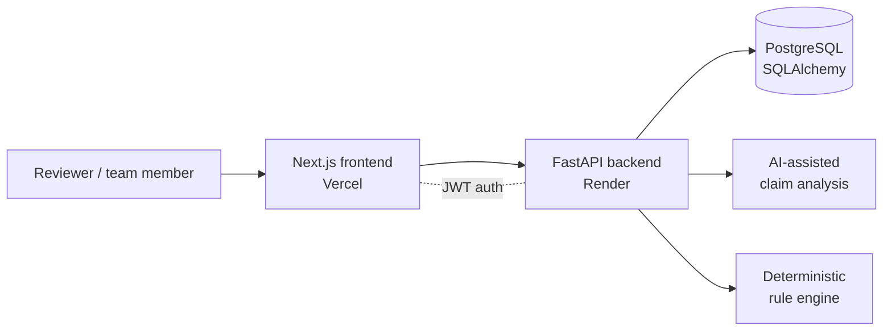
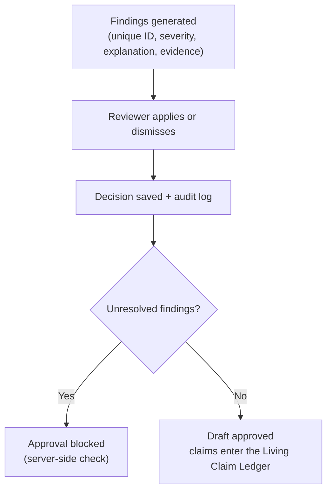

<div align="center">

#  Guardian AI

### Brand governance that doesn't stop at approval.

**The Living Claim Ledger** · Team *The Bloodline* · Inkloom AI Challenge · Round 2


</div>

---

##  Live links

| | Link |
|---|------|
| **Public judge demo** (sample data, no login) | https://guardian-ai-smoky-theta.vercel.app/demo |
| **Frontend** (Vercel) | https://guardian-ai-smoky-theta.vercel.app |
| **Backend API** (Render) | https://guardian-ai-1-nhbv.onrender.com |
| **Round 2 report (PDF)** | _add Google Drive link_ |

> The full application sits behind a login. The public demo lets you explore the product without one. See [Public demo vs. authenticated app](#-public-demo-vs-authenticated-app).

##  Problem

Brand teams publish claims about products, prices and competitors through many people, agencies and AI writing tools. Claims can be wrong, unsupported or out of date, and a claim that was correct when approved can become wrong after a price or product change. Manual review does not scale, and teams often cannot say who approved what, or on which evidence.

##  Solution

Guardian AI combines **AI-assisted analysis** with a **deterministic rule engine**, and keeps people in control:

1. Content is submitted for analysis.
2. AI-assisted processing identifies factual claims that need verification.
3. A deterministic rule engine checks predefined content and compliance risks.
4. Findings are shown with severity, explanation, evidence and a suggested edit.
5. Reviewers **apply** or **dismiss** each finding. Decisions are saved.
6. **Approval is blocked** while any finding is unresolved.
7. Approved claims are tracked in the **Living Claim Ledger**, and review and approval actions are audit-logged.

##  What works in Round 2

<div align="center">


</div>

- AI-assisted content analysis that identifies factual claims requiring verification
- Deterministic rule engine for content and compliance issues
- Review workspace with severity, explanations, evidence and suggested edits
- Apply and Dismiss decisions on individual findings
- Persistent decisions that survive a page refresh
- Unique finding IDs (UUIDs) across repeated analyses
- Server-side approval gate: a draft cannot be approved while findings are unresolved
- Living Claim Ledger for reviewed and approved claims
- Dashboard with stale-claim alerts
- Source management APIs for uploading and approving evidence sources
- Audit logging of review decisions and approval actions
- JWT authentication protecting administrative workflows
- Public interactive judge demo
- Deployed frontend (Vercel), backend (Render) and PostgreSQL database

##  Planned for Round 3 (not built yet)

These are plans, not completed features.

1. **Advanced Evidence Intelligence:** source versioning, reliable document retrieval, citation validation, and detection of outdated or contradictory evidence.
2. **Collaborative Review and Audit System:** multi-user workflows, role-based permissions, finding assignments, reviewer activity history and an auditable decision trail.
3. **Automated Continuous Claim Monitoring:** monitor reviewed content over time, detect changed claims and outdated evidence, and raise updated review alerts.

##  Public demo vs. authenticated app

| | Public demo (`/demo`) | Authenticated app |
|---|---|---|
| Login | Not needed | Required |
| Data | Sample data | Team's real reviews |
| Apply / Dismiss | Work in the browser only (local React state) | Saved to PostgreSQL |
| Backend writes | **None** | Yes |
| Approval | Not performed | Server-side approval gate |
| Registration | None | None (team accounts only) |

Nothing you do in the public demo changes production data.

##  Architecture





##  Tech stack

| Layer | Technology |
|-------|------------|
| Frontend | Next.js 16, React, TypeScript, Tailwind CSS |
| Backend | Python, FastAPI, REST APIs |
| Database | PostgreSQL with SQLAlchemy |
| Authentication | JWT |
| Analysis | AI-assisted claim identification + deterministic rule engine |
| Deployment | Vercel (frontend), Render (backend) |

##  Run locally

**Prerequisites:** Python 3.10+, Node.js 18+, PostgreSQL.

```bash
git clone https://github.com/Varun-men/Guardian_AI.git
cd Guardian_AI
```

**Backend**

```bash
cd backend
python -m venv venv
source venv/bin/activate          # Windows: venv\Scripts\activate
pip install -r requirements.txt
cp .env.example .env              # fill in the values listed in .env.example
uvicorn main:app --reload --port 8000
```

**Frontend**

```bash
cd frontend
npm install
cp .env.example .env.local        # point NEXT_PUBLIC_API_URL at the backend
npm run dev
```

Open `http://localhost:3000`. Never commit real keys or passwords; only the `.env.example` files belong in the repo.

##  Testing

Verified manually on the deployed application:

- Production deployment of frontend, backend and database
- Authentication and protected access
- Repeated analysis of content
- Unique finding IDs across repeated analyses
- Review decisions persisting after refresh
- Approval blocked while unresolved findings remain
- Public demo functionality

No accuracy or performance measurements are claimed yet. Measured results are planned for Round 3.

##  Known limitations

- The public demo uses sample data and local React state; it is not a real backend workflow.
- There is no public user registration. Real review operations need authenticated team access.
- Advanced evidence ingestion, semantic retrieval and complete source-version management are not complete.
- Continuous monitoring of approved content is not implemented.
- Findings assist reviewers and are not legal advice.

##  Team

**The Bloodline**

| Member | Focus |
|--------|-------|
| **Varun Kumar** (Team Lead) | Frontend, UI/UX and deployment |
| **Divya Vashisht** | Backend core, ledger engine, auth and audit |
| **Udit Das** | AI pipeline |
| **Sudip Sau** | Deterministic rules and evaluation |

<div align="center">

**Guardian AI: because approval is where governance begins.**

</div>
